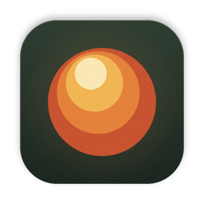
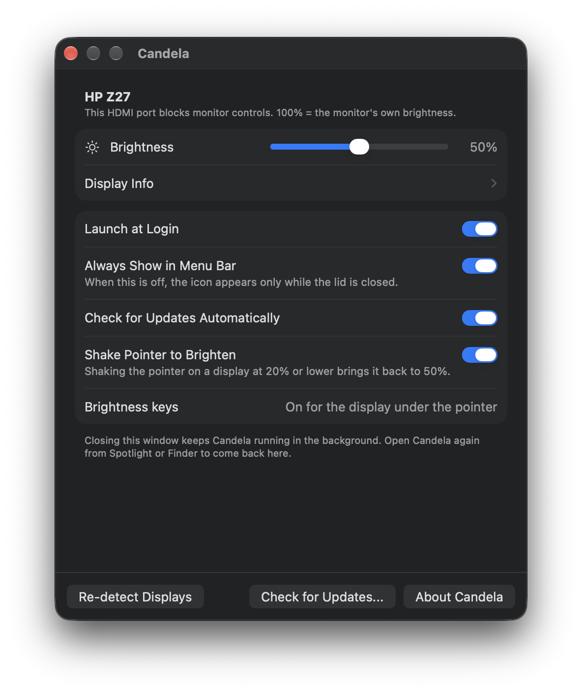
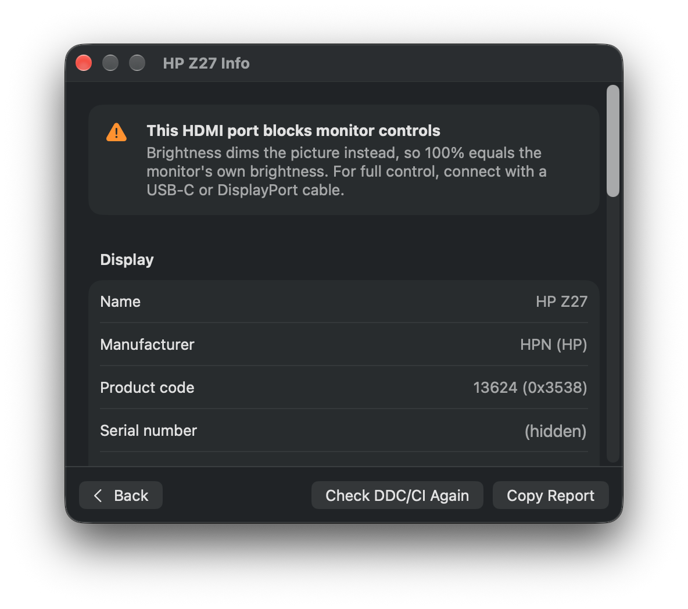

<p align="center">
  
</p>

<h1 align="center">Candela</h1>

<p align="center">
  Brightness, contrast, saturation, picture modes and volume for external displays, right from your Mac's brightness keys.<br>
  Free and open source. Apple Silicon, macOS 13 Ventura or later.
</p>

<p align="center">
  
</p>

## Features

- **The monitor's own controls over DDC/CI**: brightness, contrast, saturation, its picture
  modes and color presets, and volume on monitors with speakers. Each control appears only when
  your monitor reports it.
- **Brightness still works** on connections that block DDC/CI (such as the built-in HDMI port
  of many Apple Silicon Macs), AirPlay and other virtual displays, by dimming the picture.
- **Brightness keys** work on the display under the pointer. A small indicator in the style
  of macOS 26 appears at the top right of that display. Hold Option+Shift for fine steps.
- **No menu bar icon**: Candela runs quietly in the background. Open it to see its window.
- **Display Info**, a page in the same window: vendor, model, serial number, manufacture date,
  size, native resolution and refresh range decoded from the EDID, plus connection type,
  DDC/CI status and the monitor's full capability list. One click copies a report.
- **`candelactl`**, a command line tool for scripting and diagnostics.
- Remembers settings per monitor. No analytics, and no network access except an
  [update check](#updates) that runs only if you ask for it.

<p align="center">
  
</p>

## Compatibility

| Connection on an Apple Silicon Mac | What works |
| --- | --- |
| USB-C / Thunderbolt (video capable cable), USB-C to DisplayPort | Full hardware control (DDC/CI) |
| Built-in HDMI port on many Apple Silicon Macs (for example M1 Pro/Max MacBook Pro, M1 Mac mini, Mac Studio) | Usually software dimming only: these ports often do not pass DDC/CI |
| Docks, hubs, adapters, KVM switches | Varies; many block DDC/CI. Software dimming always works |
| AirPlay, Sidecar, DisplayLink | Software dimming |

Candela checks every display when it connects and says in its window whether it can reach the
monitor's own controls. The monitor must have DDC/CI enabled in its own on-screen menu (it
usually is by default).

Intel Macs are not supported: they use a different I2C interface.

## Install

1. Download `Candela-x.y.z.dmg` from the [Releases](../../releases) page, open it and drag
   **Candela** to **Applications**. Or install it with [Homebrew](https://brew.sh), which also
   puts `candelactl` on your path:

   ```sh
   brew tap stalwartquintessence/tap
   brew trust --tap stalwartquintessence/tap   # Homebrew asks before loading a third-party tap
   brew install --cask stalwartquintessence/tap/candela
   ```

2. Open Candela. Because it is free and not notarized by Apple, macOS blocks the first launch:
   open **System Settings > Privacy & Security**, scroll down and click **Open Anyway**.
   (Alternatively: `xattr -dr com.apple.quarantine /Applications/Candela.app`)
3. To use the brightness keys, allow Candela in
   **System Settings > Privacy & Security > Accessibility**. macOS asks once on first launch;
   later, use **Allow in System Settings** in Candela's window.

## Using Candela

Candela has no menu bar or Dock icon. It runs in the background, and the brightness keys adjust
the display under the pointer.

Open Candela from Spotlight, Finder or Launchpad to see its window; opening it again while it
runs brings the window back. Each external display gets its own section:

- **Brightness** is always there. **Contrast**, **Saturation**, **Volume**, **Picture Mode**
  and **Color Preset** appear when the monitor offers them, with the values it lists.
- **Display Info** opens the details as a page of the same window; **Back** returns.
  **Check DDC/CI Again** re-tests the connection, for example after you change cables.

The window also has **Launch at Login**, **Check for Updates Automatically** and the brightness
key permission. Closing the window keeps Candela running; to quit it, press **⌘Q** while the
window is open. When Candela starts at login it stays in the background without opening the
window.

### Updates

**Check for Updates...** at the bottom of the window looks for a newer version. If there is one,
Candela shows what changed and offers **Install Update**: it downloads the update, checks its
signature, replaces itself and restarts. The brightness key permission carries over.

To hear about updates without asking, turn on **Check for Updates Automatically**. Candela then
checks at most once a day. It is off by default.

Candela reads one small file to find out about updates,
`https://github.com/stalwartquintessence/candela/releases/latest/download/appcast.xml`, and
downloads the update from the same GitHub release when you install it. No cookies and no
information about your Mac are sent. Like any web request, it shows GitHub your IP address and
the version numbers in the `User-Agent` header (`Candela/x.y.z Sparkle/2.10.1`). If the automatic
check is off and you never click the button, Candela never goes online.

Every update is signed. Candela installs one only if its signature matches the key built into
the app and the new version carries the same code signature as the one you have.
Updates use [Sparkle](https://sparkle-project.org).

### When the monitor's controls are not reachable

If a connection blocks DDC/CI, Candela can only dim the picture, not change the backlight. That
means **100% in Candela equals the brightness set in the monitor's own menu**, never more. For
the full range, set the monitor's brightness to 100 once with its buttons and use Candela to go
lower. Changing the monitor's picture mode with its buttons also changes that ceiling.

Dimming the picture does not save power. It keeps working when you choose another color profile
or turn on Night Shift, but may interact with other tools that change gamma (for example f.lux).
Quitting Candela, or a crash, always restores normal colors.

A few monitors accept DDC/CI commands without ever replying. For those, Display Info has an
advanced option to send commands anyway. It cannot help when the connection itself blocks
DDC/CI.

## Command line

`candelactl` ships inside the app (`/Applications/Candela.app/Contents/MacOS/candelactl`).

```sh
candelactl list                  # external displays and how they are connected
candelactl info                  # full report (EDID, connection, DDC/CI, features)
candelactl probe --verbose       # does the display answer DDC/CI? shows raw I2C bytes
candelactl caps                  # the monitor's capability string, decoded
candelactl get brightness
candelactl set contrast 70
candelactl set saturation 60 -d 2   # on the second display
```

Exit code 3 means the display did not answer DDC/CI.

## Build from source

Requirements: an Apple Silicon Mac with either Xcode 26 or the free Command Line Tools for
Xcode 26 (`xcode-select --install`), which need macOS 15.6 or later. The app you build still
runs on macOS 13 or later. The only dependency, [Sparkle](https://sparkle-project.org) for
updates, is downloaded by SwiftPM at a pinned version.

```sh
./scripts/test.sh        # unit tests
./scripts/build-app.sh   # dist/Candela.app and dist/candelactl
./scripts/package.sh     # dist/Candela-x.y.z.zip, .dmg and SHA256SUMS.txt
```

The scripts detect a Command Line Tools only setup and adjust SwiftPM flags automatically.
To keep the Accessibility permission across rebuilds, run `./scripts/create-signing-identity.sh`
once; see [docs/DISTRIBUTION.md](docs/DISTRIBUTION.md#keep-permissions-across-builds).

### Project layout

```
Sources/MonitorCore   Pure logic, fully unit tested: DDC/CI packets and sessions (against a
                      simulated monitor), MCCS tables, capability strings, EDID decoding,
                      display matching, which controls each display offers, reports
Sources/MonitorIO     Hardware: IORegistry discovery, IOAVService I2C transport, gamma dimming
Sources/CandelaApp    The app (AppKit, with SwiftUI for its windows)
Sources/CandelaCLI    candelactl
Tests/                Swift Testing suites for MonitorCore
scripts/              Build, test, package, icon and release tooling
docs/                 Distribution guide and hardware investigation notes
```

## Troubleshooting

- **"No monitor controls over HDMI"**: connect through a USB-C port instead. A phone charging
  cable will not work: it must carry video (USB 3.1 Gen 2 / USB4 / Thunderbolt, or USB-C to
  DisplayPort).
- **100% is not the monitor's full brightness**: the connection blocks DDC/CI, so Candela can
  only dim below the monitor's own setting. Set the monitor's brightness to 100 with its buttons.
- **"Display does not answer DDC/CI"** on USB-C: enable DDC/CI in the monitor's menu, try
  without the dock or adapter, then run `candelactl probe --verbose` and open an issue with
  the output.
- **Brightness keys do nothing, or macOS keeps asking for permission**: in
  **System Settings > Privacy & Security > Accessibility**, remove every Candela entry, then
  click **Allow in System Settings** in Candela's window and switch Candela on. If you build from
  source, run `./scripts/create-signing-identity.sh` once first; otherwise macOS ties the
  permission to one exact build.
- **Logs**: `/usr/bin/log stream --level debug --predicate 'subsystem == "io.github.stalwartquintessence.Candela"'`
  (in zsh, plain `log` is a shell builtin, so use the full path). `--level debug` includes every
  raw I2C transaction; leave it out for just state changes and errors.

## Contributing

Bug reports with `candelactl info` and `candelactl probe --verbose` output are the most useful
contribution, especially for monitors and connections that behave unusually. See
[CONTRIBUTING.md](CONTRIBUTING.md).

## License and credits

MIT License, see [LICENSE](LICENSE). DDC/CI timing and display matching are adapted from
[MonitorControl](https://github.com/MonitorControl/MonitorControl) (MIT); see
[THIRD_PARTY_NOTICES.md](THIRD_PARTY_NOTICES.md). The app icon is original artwork generated by
`scripts/IconRenderer.swift`.

Candela uses undocumented macOS APIs for I2C access. A future macOS update could break hardware
control; software dimming uses public APIs only.
